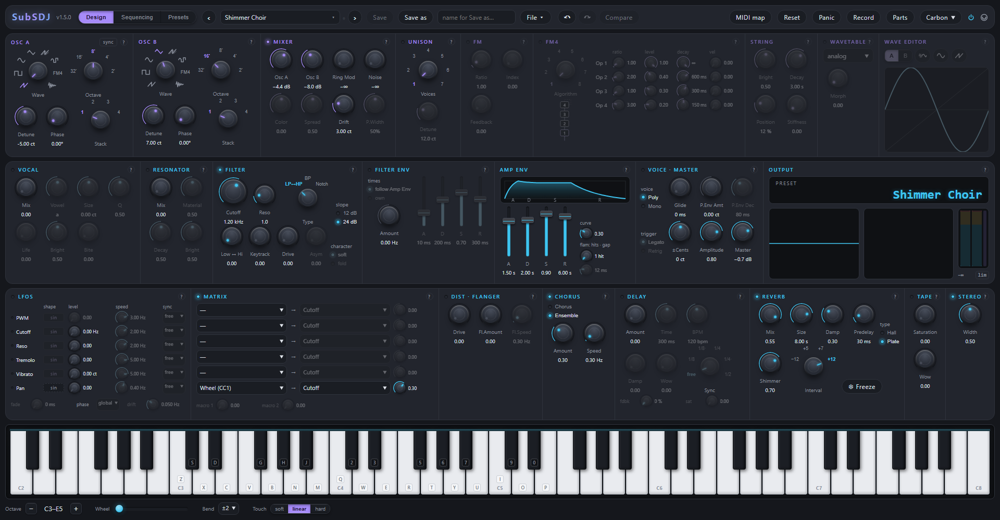

# SubSDJ

A synthesizer for the browser built with the **Web Audio API**, with no
dependencies and no build step. It started as a recreation of the old SubSDJ, a
subtractive soft-synth I wrote in VB.Net, and has grown to include FM,
wavetables, formants, resonators, a plucked string, modulation in tempo and by
steps, effects, parts and generative music.

**▶ Try it: <https://sfalbacete.github.io/subsdj/>**



## How to play it

- **Computer keyboard**, tracker style: bottom row `Z S X D C V G B H N J M`,
  top row `Q 2 W 3 E R 5 T 6 Y 7 U`; change octave with `Page Up` / `Page Down`
  (Z goes from C0 to C7, so the top row reaches C9; by default, Q is middle C).
  It goes by key position, so the piano stays in place on AZERTY or Dvorak
  too. With the mouse on the on-screen keyboard, how high on the key you click
  is the strength (velocity), and dragging with the button held plays the keys
  you pass over.
- **MIDI keyboard**: connects by itself once you accept the browser's
  permission (velocity, pitch bend, sustain and Program Change). Under the
  keyboard, **Touch** sets the velocity curve (soft, linear or hard) and
  **Bend** the preset's pitch bend range. **MIDI map** binds any hardware
  control to any control on screen.
- The audio starts with the first click or the first key: browsers don't let a
  page make sound before that.
- `Escape` or **Panic** cut every note.
- Three screens: **Design** (the sound), **Sequencing** (arpeggiator,
  sequencer, the looping envelope, Steps, parts and scenes) and **Presets** (the
  library).
- The **preset picker** in the header searches (ignoring accents and case) and
  filters by category; a click or `↑` `↓` loads to audition, `Enter` picks and
  closes, and **Browse all** opens the Presets screen.
- `Ctrl+Z` / `Ctrl+Y` undo and redo. The ● next to the preset name tells you
  something has changed, and **Compare** toggles between the saved preset and
  your edit.
- Every module has its **?** with the explanation. A dimmed control does
  nothing with the current settings, and its tooltip says why.

## Your presets

They are saved **in your browser** (localStorage), not on any server: in another
browser or on another computer they won't be there. To take them with you or
share them: **File ▾ → Export library**, and on the other side **Import…** (it
merges with whatever is there, it never replaces it). Libraries, presets and
scenes saved with 1.3.0 or earlier load as they are.

## Browsers

Developed and tested in **Chrome**; Edge uses the same engine. Firefox and
Safari haven't been tested, and Safari has no Web MIDI. If something sounds odd
after an update, reload with **Ctrl+F5**: the browser may have mixed files from
the previous version.

## Running it locally

ES modules and AudioWorklets don't work by opening `index.html` with a double
click: it has to be served over HTTP. With Node:

```
node tools/serve.mjs
```

→ <http://127.0.0.1:8000/>. The selftest is at <http://127.0.0.1:8000/?selftest=1>,
or headless with `node tools/run-selftest.mjs` (Node ≥ 22 and Chrome), which runs
it in two batches (`?selftest=1&batch=checks` and `&batch=factory`): all in a
single page can hang the browser with so many renders.

## Documentation

- [CHANGELOG.md](CHANGELOG.md): what changed in each version.
- [docs/DESIGN.md](docs/DESIGN.md): how each module works and why, with the
  measurements that validate it. It is the development notebook.
- [docs/PLAN.md](docs/PLAN.md): plans and to-dos.
- [docs/GLOSSARY.md](docs/GLOSSARY.md): the Spanish → English glossary used for
  the translation.

## Thanks

To [@tacowars](https://github.com/tacowars), who put it through its paces:
several improvements in 1.1.0 and 1.2.0 come from their ideas and comments.

## License

[GNU Affero General Public License v3.0](LICENSE) (AGPL-3.0-only).
