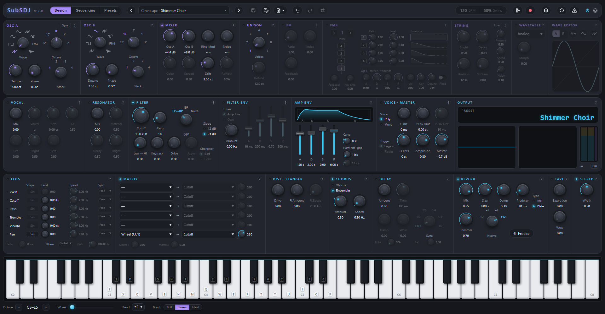

# SubSDJ

A synthesizer for the browser built with the **Web Audio API**, with no
dependencies and no build step. It started as a recreation of the old SubSDJ, a
subtractive soft-synth I wrote in VB.Net, and has grown to include FM,
wavetables, formants, resonators, a plucked string, modulation in tempo and by
steps, effects, parts and generative music.

**▶ Try it: <https://sfalbacete.github.io/subsdj/>**



## How to play it

- **Computer keyboard**, tracker style: bottom row `Z S X D C V G B H N J M`,
  top row `Q 2 W 3 E R 5 T 6 Y 7 U`; change octave with `Page Up` / `Page Down`
  (Z goes from C0 to C7, so the top row reaches C9; by default, Q is middle C).
  It goes by key position, so the piano stays in place on AZERTY or Dvorak
  too. With the mouse on the on-screen keyboard, how high on the key you click
  is the strength (velocity), and dragging with the button held plays the keys
  you pass over.
- **MIDI keyboard**: connects by itself once you accept the browser's
  permission (velocity, pitch bend, sustain and Program Change). Under the
  keyboard, **Touch** sets the velocity curve (soft, linear or hard) and
  **Bend** the preset's pitch bend range. **MIDI map** binds any hardware
  control to any control on screen.
- Under the keyboard too: **Click** is a metronome on the shared clock (the 1 of
  each bar accented; straight to the output, so the WAV recorder does not hear
  it) and **Tap** sets the tempo from your taps (from the third one, the median
  of the last intervals). **Seq Rec** records a phrase into the sequencer from
  the keys while it loops.
- The audio starts with the first click or the first key: browsers don't let a
  page make sound before that.
- `Escape` or **Panic** cut every note.
- Four screens: **Design** (the sound), **Sequencing** (arpeggiator,
  sequencer, the looping envelope, Steps, parts and scenes), **Pattern** (the loop
  of your own notes that a part repeats — with Parts on) and **Presets** (the
  library).
- **Pattern**: with Parts on, **● Rec** in the Player module (or on the Pattern
  screen) arms a take that starts with your first key; ● again closes the loop.
  On the Pattern screen, drag the notes to fix them, double-click to add or delete,
  `Ctrl` + wheel to zoom. **From pattern** in Harmony reads the key from the loop so
  the other players follow it, and **★ Save** in Arrangement keeps the scene in the
  Library.
- The **preset picker** in the header searches (ignoring accents and case) and
  filters by category; a click or `↑` `↓` loads to audition, `Enter` picks and
  closes, and **Browse all** opens the Presets screen.
- The header's buttons are icons; hovering one tells you what it is at once.
  **Save** (the floppy) updates the loaded preset with what is sounding (enabled once
  something changed; `Ctrl+S`); **Save as** (the floppy with a pencil) opens a field
  with the name and makes a new preset in «★ Mine» (`Enter` there, or `Ctrl+Shift+S`
  twice). The theme is in the **File** menu.
- The **clock** in the header holds the tempo (BPM) and the swing, which every part
  shares: drag the number up or down (`Shift` = fine) or double-click to type it.
- `Ctrl+Z` / `Ctrl+Y` undo and redo. The ● next to the preset name tells you
  something has changed, and **Compare** toggles between the saved preset and
  your edit.
- Every module has its **?** with the explanation. A dimmed control does
  nothing with the current settings, and its tooltip says why.

## The factory bank

118 presets in 12 categories by use — Bass, Leads, Brass & Strings, Keys, Plucks &
Bells, Pads, Cinescape, Motion, Percussion, Voice, FX & Textures — chosen so that
every one has a job and none sounds like another: the classics every synth bank has
and the sounds only this one does. Hover a preset in the picker or on the Presets
screen to read **how to play it** (register, note or chord, what the wheel and the
macros do); the search also finds its tags (warm, dark, rhythmic, techno, fm…). In
every preset the **wheel** opens the filter (the vowel on voices) and **Macro 1** is
its character knob. Loudness is matched by measurement; the criteria, the references
and the checks are in [docs/BANK.md](docs/BANK.md). The bank up to 1.4.0 lives in
`subsdj-bank-1.4.json`: File ▾ → Import brings any of it back.

Eight **scenes** (Presets screen) show the synth accompanying you: Night Ambient,
Dorian Dawn, Hypnotic Techno, Robot Choir, Berlin School, Dub Session, 909 Kit and
Deep Space. All but the kit reserve a part for you, with a lead loaded and its player
off: load the scene, press ▶ Play in Harmony and play along.

## Your presets

They are saved **in your browser** (localStorage), not on any server: in another
browser or on another computer they won't be there. To take them with you or
share them: **File ▾ → Export library**, and on the other side **Import…** (it
merges with whatever is there, it never replaces it). Libraries, presets and
scenes saved with 1.3.0 or earlier load as they are. When the factory bank changes,
your library follows it: the factory copies you never touched are replaced, and
anything you renamed, moved, edited or starred stays where it is. Your own presets
keep their settings across versions (a setting that changed its meaning is converted
on load, exactly). If this synth ever meets a library written by a newer version, it
keeps it aside untouched (File ▾ → Export or Discard the unreadable copy) rather than
overwrite it, and a file from a newer version is refused with a message, never half
read.

What you had not saved is not lost either: if you close the page (or the browser
crashes) in the middle of a sound, a phrase or a scene, the welcome window offers it
back next time — **CONTINUE**, or **start from Init** to leave it behind. It only asks
when there really is something unsaved.

## Browsers

Developed and tested in **Chrome**; Edge uses the same engine. Firefox and
Safari haven't been tested, and Safari has no Web MIDI. If something sounds odd
after an update, reload with **Ctrl+F5**: the browser may have mixed files from
the previous version.

## Running it locally

ES modules and AudioWorklets don't work by opening `index.html` with a double
click: it has to be served over HTTP. With Node:

```
node tools/serve.mjs
```

→ <http://127.0.0.1:8000/>. The selftest is at <http://127.0.0.1:8000/?selftest=1>,
or headless with `node tools/run-selftest.mjs` (Node ≥ 22 and Chrome), which runs
it in two batches (`?selftest=1&batch=checks` and `&batch=factory`): all in a
single page can hang the browser with so many renders.

## Documentation

- [CHANGELOG.md](CHANGELOG.md): what changed in each version.
- [docs/DESIGN.md](docs/DESIGN.md): how each module works and why, with the
  measurements that validate it. It is the development notebook.
- [docs/PLAN.md](docs/PLAN.md): plans and to-dos.
- [docs/GLOSSARY.md](docs/GLOSSARY.md): the Spanish → English glossary used for
  the translation.

## Thanks

To [@tacowars](https://github.com/tacowars), who put it through its paces:
several improvements in 1.1.0 and 1.2.0 come from their ideas and comments.

## License

[GNU Affero General Public License v3.0](LICENSE) (AGPL-3.0-only).
